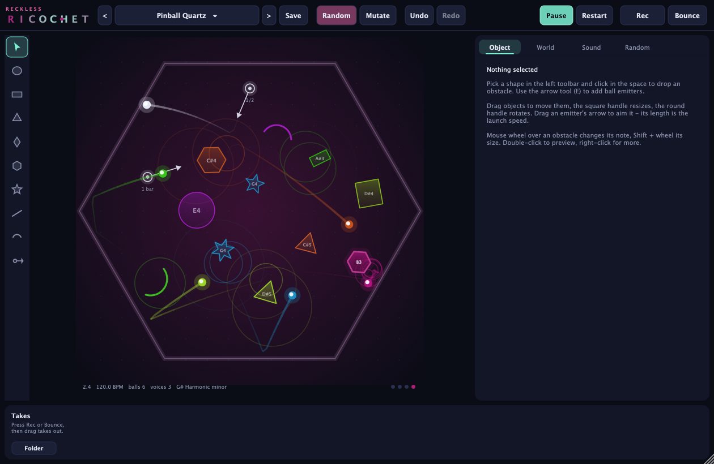
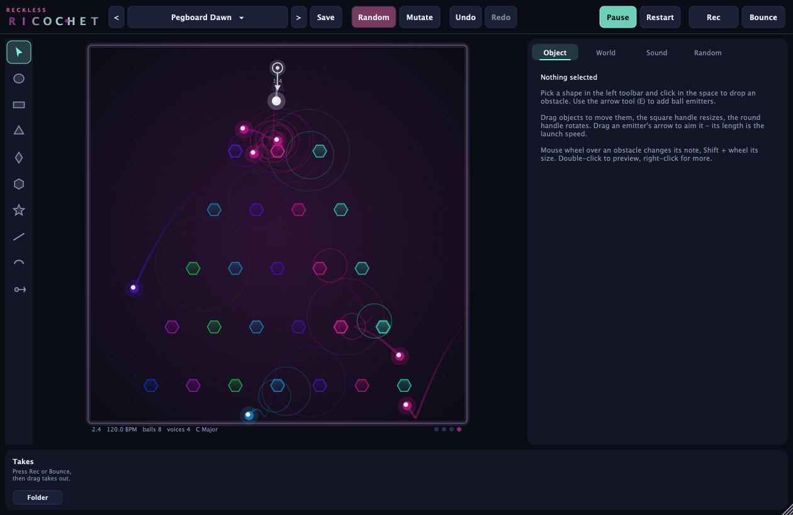
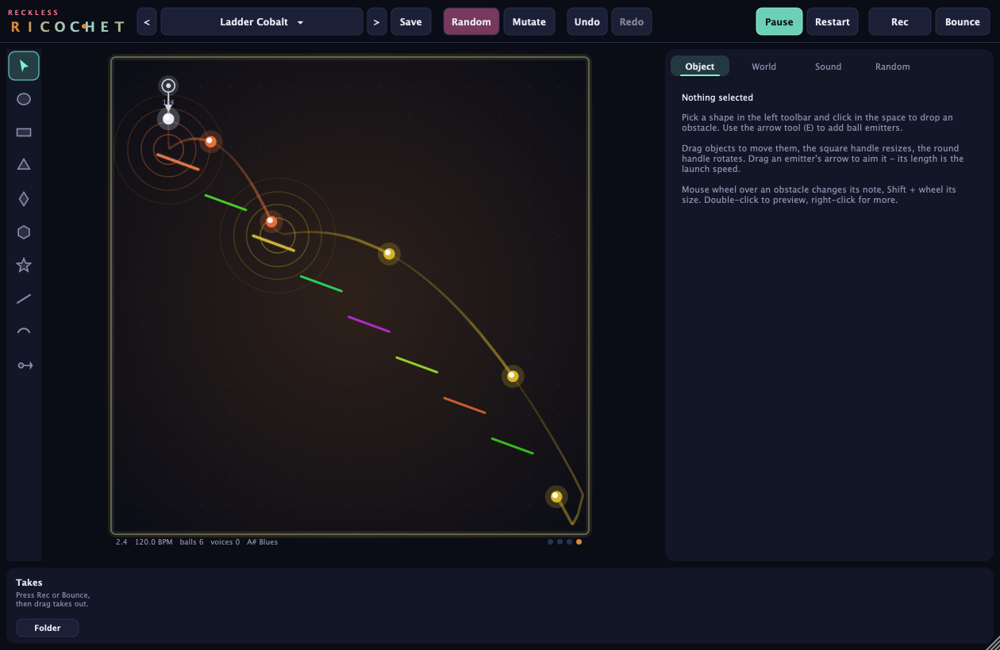

# Reckless Ricochet

**Instrument VST3 / AU génératif : des billes rebondissent sur des obstacles, chaque obstacle touché joue une note.**

*Generative VST3 / AU instrument — marbles bounce around a space you design, every obstacle they hit plays a note. (English summary at the bottom.)*



| | |
|---|---|
|  |  |

---

## Ce que ça fait

- **Un espace** (carré, cercle, hexagone ou ouvert) avec gravité, direction de la gravité, friction, rebond des murs et collisions entre billes.
- **Des émetteurs de billes** que tu places où tu veux : direction, vitesse, cadence synchronisée au tempo (1/16 … 2 mesures, triolets, pointé, « une seule fois » ou déclenché par une note MIDI), dispersion, durée de vie, nombre max de billes, taille des billes.
- **Des obstacles** : 8 formes (cercle, rectangle, triangle, losange, polygone 3–12 côtés, étoile 3–12 branches, ligne, arc), taille, étirement, rotation, **rotation animée**, élasticité, volume, mute.
- **Une note par obstacle touché** : note fixe calée sur une gamme (16 gammes, toutes tonalités), ou hauteur automatique selon la **taille** ou la **hauteur** de l'obstacle. La vélocité dépend de la force de l'impact, le panoramique de la position.
- **Quantisation** optionnelle des impacts (1/8, 1/16, 1/32) et **sortie MIDI** (pour piloter d'autres instruments).
- **8 moteurs sonores**, choisis par obstacle : Glass FM, Pluck (Karplus-Strong), Mallet (modal), Analog (soustractif), Halo Pad, Drums (kick/snare/tom/hats selon la note), Wind (bruit résonant), Chip. Bus master : drive, delay ping-pong synchronisé, reverb, limiteur.
- **168 presets d'usine** en 10 catégories (Cascades, Orbits, Rhythmic, Mechanical, Ambient, Percussion, Chaos, Minimal, Melodic, Random) + tes propres presets.
- **Random** : génère une scène complète à partir d'une graine, avec densité, chaos et verrous (garder obstacles / émetteurs / sons / monde / gamme). **Mutate** fait varier la scène actuelle.
- **Enregistrement** : bouton **Rec** (WAV 24 bits en temps réel) et **Bounce** (rendu hors-ligne de 2 à 64 mesures, déterministe). Chaque prise apparaît en bas avec sa forme d'onde : **glisse-la directement dans ton DAW ou le Finder**, ou clic droit → *Export as…*.
- **Design** : les couleurs suivent les notes (cercle des quintes → teinte, octave → luminosité), halos à l'impact, traînées des billes, fond qui prend la couleur de ce qui joue.

## Utilisation

| Action | Comment |
|---|---|
| Ajouter un obstacle | choisir une forme dans la barre de gauche (touches `1`–`8`) puis cliquer dans l'espace |
| Ajouter un émetteur | outil flèche (`E`) puis cliquer |
| Déplacer | glisser (Maj = aimanter à la grille) |
| Taille / rotation | poignée carrée / poignée ronde |
| Viser un émetteur | glisser la pointe de sa flèche (la longueur = la vitesse) |
| Changer la note | molette sur l'obstacle (Maj + molette = taille) |
| Écouter / tirer | double-clic sur un obstacle / un émetteur |
| Menu contextuel | clic droit (forme, son, note, spin, mute, dupliquer, supprimer…) |
| Supprimer / dupliquer | `Suppr` / `Cmd+D` |
| Annuler / rétablir | `Cmd+Z` / `Cmd+Maj+Z` |
| Play / pause | `Espace` |
| Random | `Cmd+R` |

Les réglages détaillés sont dans le panneau de droite : **Object** (objet sélectionné), **World** (espace, gravité, gamme, quantize), **Sound** (paramètres automatisables du son) et **Random**.

**Sync to host transport** (onglet Sound) : la simulation suit la lecture du DAW et repart du même état à chaque Play, ce qui donne exactement la même performance à chaque fois.

Les prises sont dans `~/Music/Ricochet/Recordings`, les presets utilisateur dans `~/Music/Ricochet/Presets` (fichiers `.ricochet` en JSON).

## Installation

Télécharger les binaires depuis l'onglet **Actions** (artefacts de build) ou **Releases**.

- macOS : copier `Reckless Ricochet.component` dans `~/Library/Audio/Plug-Ins/Components` et `Reckless Ricochet.vst3` dans `~/Library/Audio/Plug-Ins/VST3`. Les binaires ne sont pas notarisés : si macOS les bloque, lancer
  `xattr -dr com.apple.quarantine ~/Library/Audio/Plug-Ins/Components/"Reckless Ricochet.component" ~/Library/Audio/Plug-Ins/VST3/"Reckless Ricochet.vst3"`
- Windows : copier `Reckless Ricochet.vst3` dans `C:\Program Files\Common Files\VST3`.

## Compiler

Prérequis : CMake ≥ 3.22, un compilateur C++17 (Xcode ou Command Line Tools sur macOS, Visual Studio 2022 sur Windows).

```bash
git clone --recursive https://github.com/RecklessBoise/ricochet.git
cd ricochet
cmake -B build -DCMAKE_BUILD_TYPE=Release
cmake --build build --config Release
./build/RicochetTests_artefacts/Release/RicochetTests   # tests unitaires
```

Sur macOS les plugins sont copiés automatiquement dans `~/Library/Audio/Plug-Ins` (désactiver avec `-DRICOCHET_COPY_PLUGINS=OFF`).
`RicochetSnapshot` génère des captures de l'interface hors écran (`./build/RicochetSnapshot_artefacts/Release/RicochetSnapshot docs`).

## Architecture

```
Source/Core     Scene (modèle + JSON), Physics (simulation déterministe, pas fixe 720 Hz,
                détection continue), RenderEngine (impacts → notes → synthé → FX),
                Presets, Randomizer, OfflineRenderer (bounce WAV)
Source/Synth    Synth (8 moteurs, 32 voix), Effects (drive, delay, reverb, limiteur)
Source/UI       SceneCanvas, Inspector, TopBar, RecordingsPanel, Theme
Source/         PluginProcessor (paramètres, transport, état), PluginEditor, Recorder
Tests/          tests unitaires (physique, presets, random, audio, WAV, quantize)
```

La simulation tourne dans le thread audio, sans allocation, de façon déterministe (indépendante de la taille des buffers) : les notes tombent à l'échantillon près et le bounce hors-ligne est identique à la lecture.

## Licence

AGPL-3.0 (Reckless Ricochet est construit avec [JUCE](https://juce.com), lui-même distribué sous AGPLv3 pour les projets open source).

---

### English summary

Reckless Ricochet is a generative instrument plug-in (VST3, AU, Standalone). Place obstacles of 8 shapes, set their size, rotation and spin, drop ball emitters, aim them and pick their tempo-synced rate. Every collision triggers that obstacle's note on one of 8 built-in synth engines (scale-quantised, optional grid quantise, MIDI out). Ships with 168 presets, a seeded randomiser with locks, real-time recording and offline bounce to 24-bit WAV, with drag & drop of takes into your DAW. Colours follow the notes being played.
